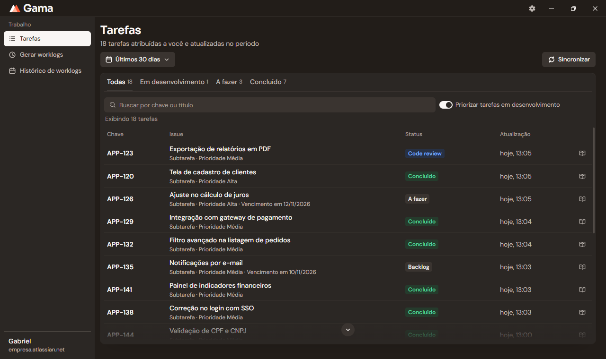
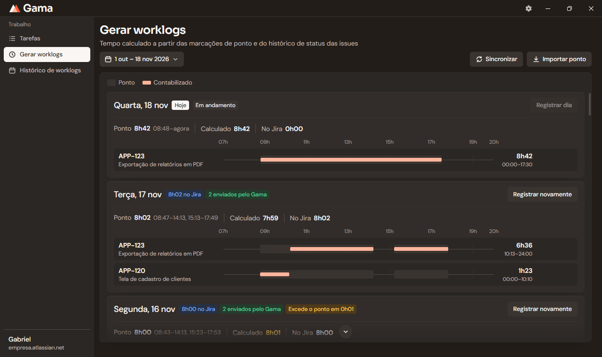
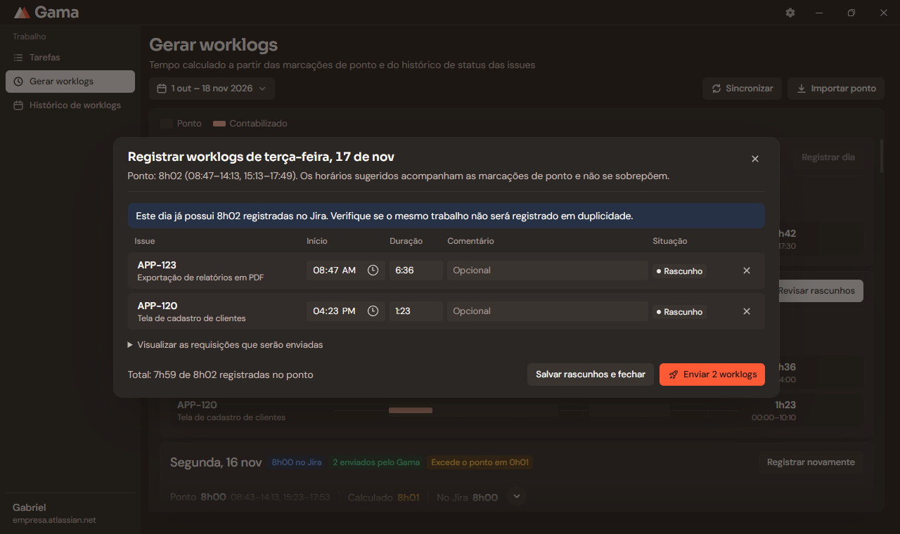
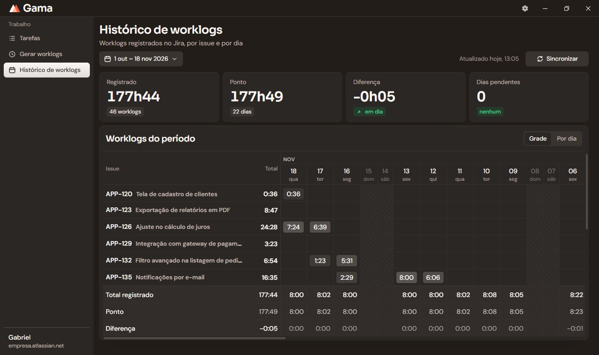

<div align="center">
  <h1>
    <picture>
      <source media="(prefers-color-scheme: dark)" srcset="branding/banner-escuro.svg">
      
    </picture>
  </h1>

  <p>
    Assistente desktop para o Jira Cloud que calcula o tempo trabalhado em cada tarefa a partir das marcações de ponto do PontoMais e registra os worklogs do dia com poucos cliques.<br>
  </p>

[](https://github.com/gabrielgriffo/gama-jira-assistant/releases/latest) [](https://www.rust-lang.org/)

  <p>
    <a href="https://github.com/gabrielgriffo/gama-jira-assistant/releases/latest">
      </a>
  </p>

</div>

O Gama cruza três fontes para descobrir em que você trabalhou em cada dia: os intervalos em que o ponto estava aberto no PontoMais, os períodos em que cada issue esteve em um status de desenvolvimento e os períodos em que ela esteve atribuída a você. A interseção desses intervalos vira uma sugestão de worklog por issue, que pode ser revisada e enviada ao Jira. Os dados ficam em um banco local, e as requisições saem da sua máquina direto para o Jira e o PontoMais, sem servidores intermediários.

## Início rápido

1. **Instale o aplicativo.** No Windows, execute `Gama_<versão>_x64-setup.exe`. Caso o SmartScreen exiba "O Windows protegeu o computador", selecione **Mais informações** e depois **Executar assim mesmo**. No Linux, instale o `.deb` ou o `.rpm` pelo gerenciador de pacotes, ou dê permissão de execução ao `.AppImage`.

2. **Conecte o Jira.** Em **Configurações → Contas → Jira**, informe a URL do site (`https://empresa.atlassian.net`), o e-mail da conta Atlassian e um [token da API](https://id.atlassian.com/manage-profile/security/api-tokens).

3. **Conecte o PontoMais.** Na mesma seção, informe o e-mail e a senha do PontoMais. Marque **Reconectar automaticamente quando a sessão expirar** para não precisar entrar de novo.

4. **Marque os status de desenvolvimento.** Em **Configurações → Status de desenvolvimento**, clique em **Sincronizar** para carregar os status do Jira, marque os que representam trabalho em andamento (por exemplo, "Em desenvolvimento") e clique em **Salvar**. Só o tempo nesses status é contado.

5. **Registre o dia.** Em **Gerar worklogs**, cada dia mostra a linha do tempo do ponto e o tempo calculado por issue. Clique em **Registrar dia**, revise os worklogs e envie.

## Interface

<table>
<tr><th>Tarefas</th><th>Gerar worklogs</th></tr>
<tr><td>

<picture>
  <source media="(prefers-color-scheme: light)" srcset="docs/screenshots/tarefas-claro.png">
  
</picture>

</td><td>

<picture>
  <source media="(prefers-color-scheme: light)" srcset="docs/screenshots/gerar-worklogs-claro.png">
  
</picture>

</td></tr>
<tr><th>Registro do dia</th><th>Histórico de worklogs</th></tr>
<tr><td>

<picture>
  <source media="(prefers-color-scheme: light)" srcset="docs/screenshots/registrar-dia-claro.png">
  
</picture>

</td><td>

<picture>
  <source media="(prefers-color-scheme: light)" srcset="docs/screenshots/historico-claro.png">
  
</picture>

</td></tr>
</table>

Os dados exibidos nas imagens são fictícios.

## Funcionalidades

- **Tarefas.** Lista as issues atribuídas a você que foram atualizadas no período, ordenadas pela última mudança de status ou de responsável, com tipo, prioridade, vencimento e o histórico completo de status de cada uma.
- **Cálculo do tempo por issue.** Para cada dia, o tempo de uma issue é a interseção entre o ponto aberto, a issue em um status de desenvolvimento e a issue atribuída a você. Issues que trocaram de responsável no meio do dia contam apenas o trecho em que eram suas.
- **Linha do tempo do dia.** As marcações de ponto e os trechos de cada issue aparecem em barras no eixo das 7h às 19h. Dias com marcação ímpar são indicados como abertos (hoje) ou incompletos (dias passados).
- **Revisão antes do envio.** A prévia do dia permite ajustar o início, a duração e o comentário de cada worklog. Os rascunhos editados são mantidos ao trocar de tela até o envio, enquanto o aplicativo estiver aberto; os que não foram alterados são descartados ao fechar a prévia.
- **Correção pelo ponto.** O botão **Corrigir** distribui na issue a diferença entre o total de ponto e o total calculado, para que o dia feche com as horas trabalhadas.
- **Confirmação no Jira.** Depois do envio, o Gama busca o worklog no Jira e só então marca o dia como registrado. Cada dia mostra quanto tempo já existe no Jira e quantos worklogs foram enviados pelo Gama, e o botão passa a **Registrar novamente** quando já há registro.
- **Histórico de worklogs.** Compara o tempo registrado no Jira com o tempo de ponto, com indicadores de total, diferença e dias pendentes. A visualização por dia lista cada worklog, e a visualização em grade mostra uma linha por issue e uma coluna por dia, agrupadas por mês.
- **Cache local com sincronização em segundo plano.** Cada tela abre com os dados já conhecidos e é atualizada à medida que o Jira responde. Um intervalo mínimo evita buscas repetidas ao trocar de tela.
- **Tema claro, escuro ou do sistema.**
- **Atualização automática.** Ao abrir, o Gama verifica se há uma versão nova, baixa em segundo plano e mostra **Atualizar agora** na barra lateral. A instalação só acontece depois da confirmação, e o aplicativo reinicia em seguida. A assinatura de cada atualização é conferida antes da instalação.
- **Credenciais no cofre do sistema.** O token do Jira e a senha do PontoMais ficam no Gerenciador de Credenciais do Windows ou no keyring do Linux, fora do banco e do webview.

## Configurações

| Opção | Descrição |
|---|---|
| Tema | Claro, escuro ou o tema do sistema. |
| Intervalo mínimo entre sincronizações | Tempo mínimo entre duas buscas no Jira ao abrir as telas: sempre, 1, 5, 15 ou 30 minutos, 1 hora, ou só pelo botão **Sincronizar**. |
| Jira | URL do site, e-mail e token da API. Mostra a conta conectada e permite desconectar. |
| PontoMais | E-mail e senha, com a opção de reconectar automaticamente quando a sessão expirar. |
| Status de desenvolvimento | Status do Jira, agrupados por categoria, em que o tempo da issue é contado. |
| Atualizações | Mostra a versão instalada e permite verificar manualmente se há uma versão nova. |
| Apagar dados locais | Remove tarefas, histórico de status, worklogs e marcações de ponto guardados neste computador. As contas continuam conectadas. |

## Limitações conhecidas

- **Somente Jira Cloud.** O Gama usa a API REST v3 e a autenticação por token da Atlassian; Jira Server e Data Center não são suportados.
- **Depende do PontoMais.** Sem as marcações de ponto, não há intervalos de trabalho e nenhum tempo é calculado.
- **Depende do histórico de status.** Issues sem transição para um status de desenvolvimento no dia não recebem tempo, mesmo que você tenha trabalhado nelas.
- **Sobreposição de issues.** Quando duas issues estão em desenvolvimento ao mesmo tempo, o trecho comum é contado nas duas. Use a prévia ou o botão **Corrigir** para ajustar o dia.
- **"Registrar novamente" não substitui.** A ação cria novos worklogs no Jira; os anteriores precisam ser removidos no próprio Jira, se for o caso.
- **Requisitos.** Windows 10 ou 11, 64 bits. Linux 64 bits com WebKitGTK 4.1 (Ubuntu 22.04 ou superior) e um keyring compatível com Secret Service, como o `gnome-keyring`.
- **Instalador sem assinatura.** O SmartScreen e alguns antivírus podem solicitar confirmação na primeira execução.

## Detalhes técnicos

<details>
<summary><strong>Como o tempo é calculado</strong></summary>

As marcações ativas do dia são agrupadas em pares de entrada e saída e convertidas para UTC no fuso do perfil do Jira. Em seguida, o changelog de cada issue candidata (atribuída a você hoje ou em algum momento) é reconstruído em dois conjuntos de intervalos: em que ela esteve em um status de desenvolvimento e em que ela esteve atribuída a você.

| Etapa | Resultado |
|---|---|
| Status de desenvolvimento ∩ atribuída a você | Intervalos em que a issue era sua e estava em andamento |
| Resultado ∩ ponto aberto | Tempo contado da issue no dia |

O início sugerido do worklog é o começo do primeiro trecho contado. Com número ímpar de marcações, o último intervalo vai até o momento atual quando o dia é hoje e é descartado nos dias passados. Sábados e domingos só aparecem quando têm marcação, issue trabalhada ou worklog.

</details>

<details>
<summary><strong>Envio e confirmação dos worklogs</strong></summary>

Os worklogs são enviados um a um com `POST /rest/api/3/issue/{key}/worklog`, com o início formatado no fuso do Jira. A resposta é gravada no banco como não confirmada e, em seguida, o Gama consulta os worklogs da issue no Jira em uma janela de um minuto em torno do início. Só depois que o worklog aparece nessa consulta ele passa a contar no total "no Jira" do dia. As sincronizações seguintes também confirmam os worklogs pendentes.

Se parte dos envios falhar, os que foram aceitos continuam registrados e os demais ficam na prévia para uma nova tentativa.

</details>

<details>
<summary><strong>Sincronização</strong></summary>

Cada tela segue o mesmo padrão: devolve imediatamente o que está no banco local e inicia a busca no Jira em segundo plano. A tela é recarregada a partir do banco quando a busca termina, sem disparar uma nova sincronização. Uma trava impede duas sincronizações simultâneas do mesmo recurso, e uma troca de período durante a busca é processada logo em seguida.

As datas são tratadas no fuso do perfil do Jira, e os períodos são convertidos em intervalos UTC com fim exclusivo, para que um worklog das 22h apareça no dia certo.

</details>

<details>
<summary><strong>Onde ficam os dados</strong></summary>

| Dado | Windows | Linux |
|---|---|---|
| Banco local (`gama.db`) | `%APPDATA%\com.gabrielgriffo.gama\` | `~/.local/share/com.gabrielgriffo.gama/` |
| Preferências (`preferences.json`) | `%APPDATA%\com.gabrielgriffo.gama\` | `~/.config/com.gabrielgriffo.gama/` |
| Logs | `%LOCALAPPDATA%\com.gabrielgriffo.gama\logs\` | `~/.local/share/com.gabrielgriffo.gama/logs/` |
| Token do Jira e senha do PontoMais | Gerenciador de Credenciais do Windows | Keyring do sistema (Secret Service) |

Os logs registram o método e a URL de cada requisição ao Jira e ao PontoMais, o que inclui o endereço do seu site Jira e as chaves das issues. Revise o conteúdo antes de publicá-lo.

</details>

<details>
<summary><strong>Compilação</strong></summary>

Pré-requisitos:

- [Node.js](https://nodejs.org/) 22.18, 24 ou superior
- [Rust](https://www.rust-lang.org/tools/install) com a toolchain `stable`
- [Pré-requisitos do Tauri](https://v2.tauri.app/start/prerequisites/) para o sistema operacional utilizado
- No Linux: `libdbus-1-dev` e um provedor Secret Service, como o `gnome-keyring`

```bash
# Instalar as dependências
npm install

# Ambiente de desenvolvimento (Angular + Tauri)
npm run tauri dev

# Testes do frontend e do backend
npm test
cd src-tauri && cargo test --lib

# Compilação de produção
npm run tauri build
```

Os instaladores são gerados em `src-tauri/target/release/bundle/`. Uma tag `v<versão>` publicada no GitHub dispara o workflow `.github/workflows/release.yml`, que compila para Windows e Linux, ajusta a versão em `package.json`, `Cargo.toml` e `tauri.conf.json` e publica a release com a tabela de downloads. O workflow também assina os pacotes de atualização e publica o `latest.json` consultado pelo atualizador; para isso, os secrets `TAURI_SIGNING_PRIVATE_KEY` e `TAURI_SIGNING_PRIVATE_KEY_PASSWORD` precisam estar configurados no repositório. Builds locais com `npm run tauri build` não geram esses pacotes e não precisam da chave.

Tecnologias:

- **Interface:** Angular 20 e TypeScript
- **Aplicativo desktop:** Rust e Tauri 2
- **Banco local:** SQLite com [`sqlx`](https://crates.io/crates/sqlx)
- **Integração com as APIs:** [`reqwest`](https://crates.io/crates/reqwest)
- **Credenciais:** [`keyring`](https://crates.io/crates/keyring) e [`zeroize`](https://crates.io/crates/zeroize)

O backend é dividido em camadas: `domain` (modelos e cálculo do tempo trabalhado), `application` (serviços de sincronização, linha do tempo e envio), `infrastructure` (banco, clientes HTTP e cofre de credenciais) e `presentation` (comandos Tauri chamados pela interface).

</details>

## Aviso legal

O Gama é um projeto independente e não tem afiliação, autorização ou endosso da Atlassian nem da PontoMais. Os nomes Jira e PontoMais são usados apenas para indicar compatibilidade. O acesso às duas APIs usa exclusivamente as credenciais fornecidas pelo próprio usuário.

O tempo calculado é uma sugestão baseada no ponto e no histórico das issues. Revise os worklogs antes de enviá-los: a responsabilidade pelo que é registrado no Jira é de quem envia.

## Suporte

O Gama é mantido por uma única pessoa. Problemas e sugestões são bem-vindos nas [issues](https://github.com/gabrielgriffo/gama-jira-assistant/issues), mas não há prazo garantido de resposta.

Ao relatar um problema, anexe o log mais recente da pasta de logs indicada em [Onde ficam os dados](#detalhes-técnicos).

© [Gabriel](https://github.com/gabrielgriffo)
